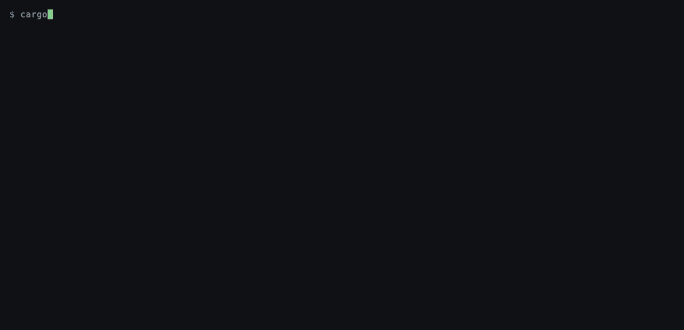
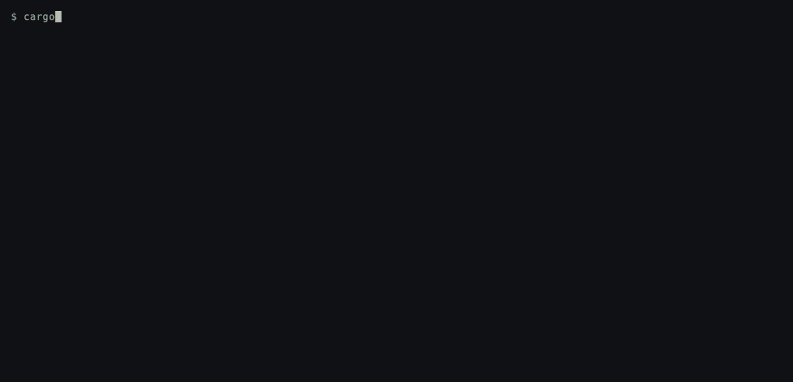
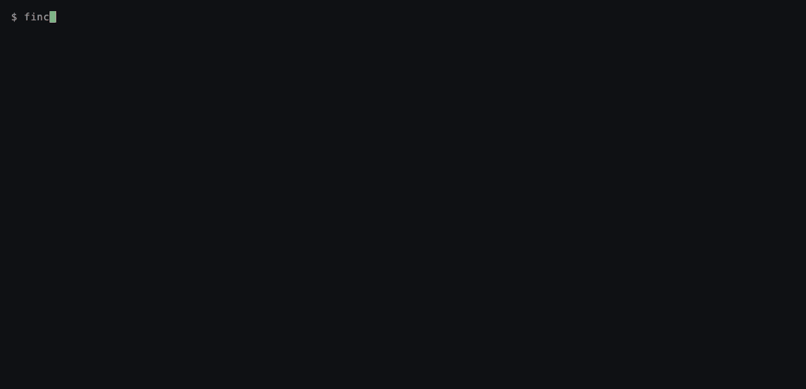
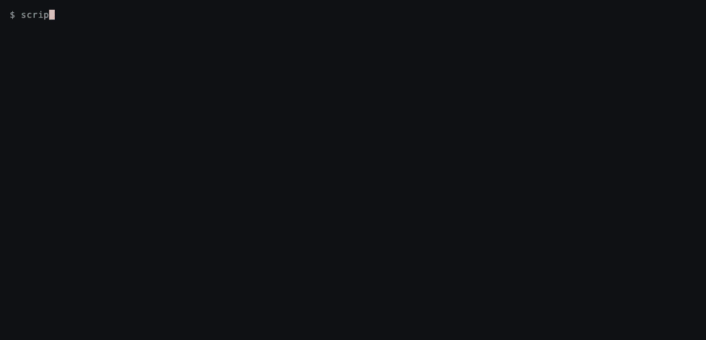

# finchart

A terminal-first financial charting engine in Rust. Live candles, order flow,
Level 2 depth and a liquidity heatmap, rendered as plain text that runs in any
terminal and over SSH.

<p align="center">
  
</p>
<p align="center"><sub>
  <code>cargo run --release -p examples-live</code>: ticks fold into the forming
  candle, the order-flow panels and the depth ladder in real time.
</sub></p>

<p align="center">
  
</p>
<p align="center"><sub>
  <code>cargo run --release -p examples-tui</code>: zoom from 200 candles to all
  5,000 and back. The bar count stays at what the screen can hold.
</sub></p>

## Why This Exists

Most charting libraries optimize for one lane:

- Generic dashboard charts.
- Basic candlestick charts.
- Commercial trading terminals.
- Scientific high-performance rendering.
- Simple terminal plots.

This project aims at the gap between them: an open, developer-facing,
high-performance financial charting engine that treats order-flow and terminal
workflows as first-class features instead of plugins or afterthoughts.

In practice that means the terminal is the primary backend, not an export path.
The engine is built around market data rather than around a renderer. Trades
carry their aggressor side, so delta and cumulative delta come for free. The
order book is part of the chart. Every frame is a pure function of the data, so
the same output can be tested, diffed, sent over SSH, or compiled to WebAssembly.
I built it to watch my C++ matching engine work. The point there is not the bars
but what they summarize: who was aggressive, where size was resting, and how the
book reacted.

- [In the terminal](#in-the-terminal) · [Quick start](#quick-start) ·
  [How it works](#how-it-works) · [Performance](#performance) ·
  [Limitations](#limitations-and-status) · [Layout](#repository-layout)

## In the terminal

Every view below is a real run of a binary in this repository, recorded with
[VHS](https://github.com/charmbracelet/vhs) from scripts in `docs/media/` (see
[Re-recording the demos](#re-recording-the-demos)).

### Live candle building — `examples-live`

```bash
cargo run --release -p examples-live            # q / Esc quits; --fps N sets the pace
```

A seeded synthetic tick stream (`seed = 42`, so the data is identical every run)
feeds the chart. Each tick mutates the **forming candle** in place; at an interval boundary
it rolls over to a new one. Under the price plot are a volume panel and a
**delta panel**: aggressive buy minus sell volume per bar, green above the
baseline and red below. The status line tracks the forming candle's OHLC, its
delta (`Δ`), the session's cumulative delta (`CVD`), and best bid/ask and spread.
On a wide enough terminal it also shows the last frame's update and render time in
microseconds. On the right is a six-level **Level 2 ladder**.

### Navigating history — `examples-tui`

```bash
cargo run --release -p examples-tui             # h/l or ←/→ pan · k/j or +/- zoom · r reset · q quit
```

A 5,000-candle deterministic series in a pan-and-zoom viewer. Watch the status
line: `5000 candles → 38 bars`. When the visible candles outnumber the screen
columns, finchart **aggregates** them into bars that keep the true open, high,
low, close and summed volume, instead of overplotting. Render cost therefore
follows the size of the terminal, not the size of the data.

### Replaying matching-engine sessions

Recorded sessions replay through the same chart, frame by frame:

```bash
scripts/play-recording.sh web/scenarios/large_buy_sweep.txt --from 112 --to 176 \
  -- --interval-secs 1 --tick-size 0.01 --window 48 --heatmap
```



**A sweep through a deep book.** For about seventy seconds the market trades
quietly at 500.00 with roughly 19,000 shares resting per side. Then one
participant buys 10,000 shares at once. The volume and delta panels spike on a
single bar, almost all of it buyer-initiated (10,312 of 10,722 shares). The
**heatmap** behind the bars, where red is resting asks and green is resting bids,
shows the ask band being consumed and the book re-forming higher within seconds.
The ladder recovers its depth; the price does not come back.

```bash
scripts/play-recording.sh web/scenarios/liquidity_crisis.txt --from 262 --to 326 \
  -- --interval-secs 1 --tick-size 0.01 --window 48 --heatmap
```



**A liquidity crisis.** The same kind of buying against a different book. Two
minutes of calm, then liquidity providers withdraw. The ask ladder thins from six
levels to three, the red shading fades out of the heatmap, and when buying
arrives it runs through the gap. By the end the ask side is empty (`spr —`) and
the last bars jump into the space where liquidity used to be. Put next to the
sweep, it shows that the depth of the book, not the size of the order, decides
how far price moves.

The three sessions in `web/scenarios/` (`normal_market`, `large_buy_sweep`,
`liquidity_crisis`) are three-minute runs of my separate C++ price-time-priority
matching engine (not included here). Every trade in them was matched among
simulated participants: market makers, noise traders, a layering "spoofer" and
large directional orders. They were captured through this repository's gRPC
adapter. They are simulations, not exchange data. `play-recording.sh` renders
each frame with the adapter's offline `--replay` of the session up to that
heartbeat, so every frame is the exact state at that moment of the run.

### Scriptable output

Every view is also available as plain text for files, diffs and CI. Frames are
byte-identical across runs for the same input:

```bash
cargo run --release -p examples-bench -- --snapshot artifacts/tui     # static chart: plain, ANSI, HTML + metrics.json
cargo run --release -p examples-live  -- --snapshot artifacts/live    # forming candle before / mid / after roll-over
cargo run --release -p examples-live  -- --record artifacts/feed/events.txt   # write the synthetic event stream
cargo run --release -p examples-live  -- --replay artifacts/feed/events.txt   # fold it back and print a frame
cargo run --release -p examples-matching-engine -- --replay web/scenarios/normal_market.txt \
  --interval-secs 1 --tick-size 0.01 --heatmap                         # final frame of a session (ANSI on a TTY, plain when piped)
```

`examples-live --scenario <name> --snapshot <dir>` renders scripted book
structures (`ask-wall`, `bid-wall`, `ask-wall-pulled`, `bid-wall-pulled`, `sweep`,
`bid-reload`) to exercise the heatmap and trade-marker layers. The price line in
those frames is a placeholder, not built from trades. `artifacts/` is gitignored.

### Live from a matching engine

```bash
cargo run --release -p examples-matching-engine -- --endpoint http://127.0.0.1:50051 --symbol AAPL \
  --interval-secs 1 --tick-size 0.01 --heatmap --record session.txt
```

This needs a running engine reachable over gRPC; the engine is a separate project.
The adapter streams fills, polls Level 2 snapshots and draws the live chart.
`--record` writes the session to a file that the replay commands above can read.
For unattended capture, `--headless --duration <secs>` records without drawing
the chart.

## Quick start

Requires Rust **1.96** or newer (`rustup update stable`). No system packages are
needed; the gRPC adapter's `protoc` is vendored.

```bash
git clone https://github.com/chiefmanny/finchart && cd finchart
cargo build --release
cargo test                                   # the whole workspace
cargo run --release -p examples-live         # q to quit
```

The viewers fill the terminal; a window of at least 120×31 is best. Replay frames
are a fixed 120×30.

## How it works

```text
 sources                     market-core                         render-core           backend-terminal
 ───────                     ───────────                         ───────────           ────────────────
 synth::events(seed) ─┐                                          Viewport (index      render_chart(view, opts)
 recorded .txt file  ─┼─► MarketEvent ─► ChartState::apply ─┐     range; pan/zoom/       → String
 gRPC adapter        ─┘                                     │     tail)                  · status line
                                  ┌─────────────────────────┤        │                   · price gutter + bars
                                  ▼                         ▼        ▼                   · heatmap layer
                        CandleBuilder            OrderBook        cull ─► CulledView       · volume / delta panels
                        · forming candle         (BTreeMap per     (zero-copy column      · depth ladder
                          = last element           side, integer    slices)               · UTC time axis
                        · buy/sell volume          price ticks)        │
                        · CVD                         │                ▼                 consumers:
                              │                       ▼             aggregate ─► Bars      crossterm viewers
                              ▼                  LiquidityHeatmap   (LOD: buckets          HTML export
                        CandleSeries             (bounded VecDeque  candles when they      WASM
                        (one Vec per field)       of bid/ask        exceed columns)
                                                  columns)
```

- **One ingestion path.** Every source produces neutral `MarketEvent`s (`Trade`,
  `DepthSnapshot`, `DepthUpdate`, `Heartbeat`), and a single `ChartState::apply`
  folds them into candles, the book and the heatmap.
- **Columnar storage.** `CandleSeries` keeps one `Vec` per field (`ts`, OHLC,
  `volume`, `buy_volume`, `sell_volume`). Culling a viewport borrows slices of
  those columns; nothing is copied.
- **Incremental updates.** The forming candle is simply the last element and is
  mutated in place. Rendering, aggregation and follow-latest need no special case
  for live data.
- **Exact price keys.** The book and heatmap key levels by integer tick
  (`round(price / tick_size)`), so repeated updates hit the same level and each
  side stays sorted. Prices remain `f64` at the API.
- **Heartbeats set the heatmap cadence.** `MarketEvent::Heartbeat` records a
  heatmap column. The data source decides the sampling rate, and the book stays a
  faithful mirror of the feed.
- **Deterministic record/replay.** Events serialize to one text line each (`T`,
  `S`, `U`, `H`) using `f64`'s shortest round-trip formatting. Replaying a file
  into a fresh `ChartState` reproduces the original state exactly; tests assert
  this.
- **A pure renderer.** `render_chart(&view, &options) -> String` has no I/O, no
  clock and no terminal dependency. It also draws annotations: a labelled rule at
  a timestamp.
- **Dependencies stay at the edges.** `market-core`, `render-core` and
  `backend-terminal` use only `std`: the RNG, ANSI and HTML output, and the
  epoch→UTC formatter are hand-written. `crossterm` lives only in the viewer
  binaries, `tonic`/`prost`/`tokio` only in the gRPC adapter, `wasm-bindgen` only
  in `finchart-web`.

Used as a library, the pipeline is a few calls:

```rust
use backend_terminal::{render_chart, ChartOptions};
use market_core::{parse_events, replay_events, CandleSeries, ChartState};
use render_core::{cull, Viewport};

let mut state = ChartState::from_history(CandleSeries::new(), 1, 0.01, Some(160), 64);
replay_events(&mut state, &parse_events(&std::fs::read_to_string("session.txt")?));

let series = state.series();
let view = cull(series, &Viewport::tail(series.len(), 60));
print!("{}", render_chart(&view, &ChartOptions { width: 120, height: 30, ..Default::default() }));
```

## Performance

`cargo run --release -p examples-bench` generates a series, culls a 200-candle
viewport and renders a 120×40 frame, averaging repeated runs. Measured on an
Apple M4; your numbers will differ, but the pattern should not.

| Candles in series | Generate | Cull | Render | Memory (columns) |
|---:|---:|---:|---:|---:|
| 10,000 | 0.10 ms | 15 ns | 6.8 µs | 0.46 MiB |
| 100,000 | 0.92 ms | 17 ns | 6.2 µs | 4.58 MiB |
| 1,000,000 | 9.98 ms | 16 ns | 7.4 µs | 45.78 MiB |

Culling sets two slice bounds and rendering touches only what is on screen, so
both stay flat while the series grows 100×. A full frame takes microseconds,
well under one 60 Hz refresh (16.7 ms).

## Also in the browser

The same renderer compiles to WebAssembly (`finchart-web`). A static page in
`web/` replays the recorded sessions in an [xterm.js](https://xtermjs.org/)
terminal, with play/pause, pan and zoom. It is the terminal output shown in a
browser, not a separate graphics backend.

```bash
rustup target add wasm32-unknown-unknown && cargo install wasm-pack
./web/build.sh && python3 -m http.server --directory web   # http://localhost:8000
```

See [`web/README.md`](web/README.md) for details.

## Limitations and status

This is a personal engineering project at version 0.1, not a published crate.
The API is unstable.

- **Text rendering only.** There is no Canvas or WebGPU backend.
- **Heatmap and candles share the price axis, not the time axis.** The heatmap
  draws one column per heartbeat, newest at the right edge. Candles exist only for
  intervals that had trades, three columns each. Over a full window the spans
  roughly line up, but individual columns do not correspond, and in sparse trading
  they drift apart.
- **Arrival-time bucketing.** The engine's fill messages carry no timestamp, so
  the live adapter stamps events on receipt. Live candles therefore depend on
  arrival timing. Replays are deterministic.
- **Placeholder candles in scripted scenarios.** See
  [Scriptable output](#scriptable-output).
- **Not yet built:** indicators, footprint charts, drawing tools, exchange
  connectors, persistence. These are out of scope until there is a milestone for
  them.

## Repository layout

```text
crates/market-core/        MarketEvent, ChartState, CandleSeries/CandleBuilder, OrderBook,
                           LiquidityHeatmap, seeded generators, scripted scenarios
crates/render-core/        Viewport, cull → CulledView, aggregate (LOD), price/time scales
crates/backend-terminal/   render_chart (plain / ANSI), annotations, HTML export, UTC time axis
examples-live/             live viewer, snapshots, scenarios, record/replay
examples-tui/              interactive pan/zoom viewer
examples-bench/            benchmark table and static snapshots
examples-matching-engine/  gRPC adapter: engine streams → MarketEvent (+ vendored proto)
finchart-web/              wasm-bindgen wrapper (WasmChart)
web/                       browser player + recorded sessions in web/scenarios/
scripts/play-recording.sh  terminal playback of a recorded session
docs/                      design notes per milestone; docs/media/ holds the demo tapes
```

Design notes for each milestone are in [`docs/`](docs/), starting with
[`docs/mvp.md`](docs/mvp.md). [`docs/verification.md`](docs/verification.md)
describes the snapshot workflow, and [`docs/research.md`](docs/research.md) surveys
existing charting engines.

### Re-recording the demos

```bash
brew install vhs            # or see https://github.com/charmbracelet/vhs; also needs ffmpeg
docs/media/render.sh        # all four, or one of: live tui sweep crisis
```

Each `docs/media/<name>.tape` is the script for one recording. `render.sh` builds
the binaries, runs the tape, and re-encodes the output to a 10 fps, 64-color GIF
plus a static PNG still (`docs/media/*.png`) for places that can't play GIFs.
